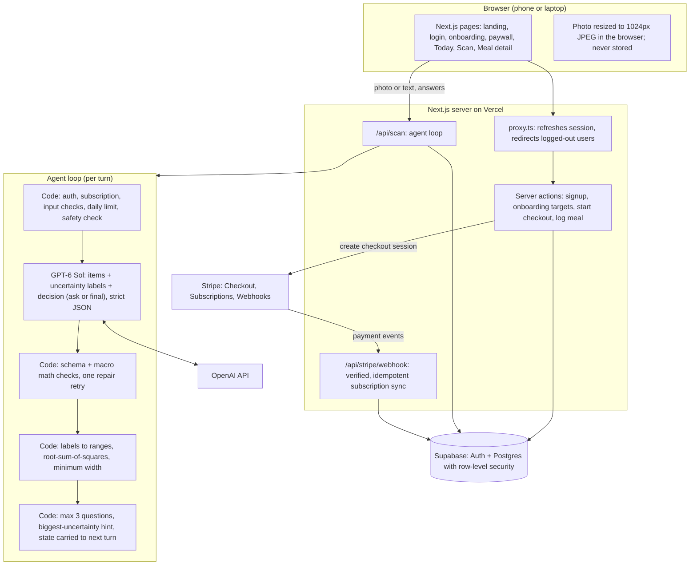

# No Cap Cals

**Calories, no cap.** Snap a meal and get an honest calorie range. When the photo can't tell how something was cooked or how much you ate, an AI agent asks one quick question at a time, and the range tightens with each answer.

**Live app:** https://no-cap-cals.vercel.app
Test payments use Stripe sandbox card `4242 4242 4242 4242`, any future date, any CVC.

## What it does

1. Sign up, set a daily target (standard formula with a safety floor), and start a 3-day free trial through Stripe.
2. Take or upload a meal photo, or describe the meal in text.
3. The agent itemizes the meal and either finishes or asks up to 3 tappable questions, each targeting the biggest source of uncertainty. "Not sure" skips one question; "Skip, just estimate" skips the rest.
4. The result shows the calorie range as the headline, a best single estimate (red dot, with Copy for other trackers), a trail showing how each answer narrowed the range, and editable portions.
5. Log it. The Today page tracks the day's estimate against the target; tap any meal to reopen its full result.

## Architecture



**Split of responsibilities:** the model does one thing per turn, reading the meal and deciding whether to ask. Code does everything else: security, payments, limits, macro checks, and every number shown to the user.

## Design decisions

See [docs/decisions.md](docs/decisions.md) for each decision with the alternative and the reason. Highlights:

- **One agent, not several.** Uncertainty lives in the meal, not in the model's reasoning, so a second checker agent adds latency without new information. Correctness is enforced by code; question quality is graded offline.
- **The model labels uncertainty; code computes ranges.** Item labels (low, medium, high) map to widths, combined by root-sum-of-squares, then calibrated against eval data.
- **State across turns** and **biggest-uncertainty targeting** came from testing: portions drifted between turns, and early questions targeted oil while chicken portion drove the range.
- **Photos are never stored.** The browser resends the resized image each turn.

## Repository structure

```
app/
  page.tsx                 landing
  login/                   auth form and server actions
  onboarding/              targets form (Mifflin-St Jeor with a calorie floor)
  paywall/                 plans and Stripe checkout action
  today/                   daily dashboard, activation poller, timezone sync
  scan/                    scan flow (client), log and delete meal actions
  meals/[id]/              meal detail page
  api/scan/                agent loop endpoint
  api/stripe/webhook/      Stripe webhook
components/estimate-view.tsx   range headline, best-estimate dot, narrowing trail
lib/ai/                    prompt, JSON schema, agent call, range math, safety check
lib/nutrition/targets.ts   daily calorie and protein targets
lib/supabase/              browser, server, admin clients and session proxy
lib/access.ts              profile and subscription gating
supabase/migrations/       tables and row-level security as SQL
evals/                     eval cases, runner, results
scripts/try-scan.ts        run the agent on one photo in the terminal
docs/decisions.md          design decisions log
```

## Security and production readiness

- Row-level security on every table; users can only read and write their own rows. Subscription status is written only by the webhook with a server-only key.
- Stripe webhooks are signature-verified, deduplicated by event ID, and re-fetch the latest subscription so event order doesn't matter.
- Secrets live in environment variables (`.env.local` locally, Vercel in production). Only the Supabase URL and publishable key are exposed to the browser, by design.
- Every scan checks login and subscription on the server. 30 scans per user per day. OpenAI spend capped at the account level.
- Prompt-injection defense: text in photos, notes, and answers is treated as data; output is forced into a strict schema; the model has no tools or database access.
- Every failure (not food, timeout, bad image, model error, payment pending) has a designed screen.

## Evaluation

```
npx tsx evals/run-eval.ts
```

Reads `evals/cases.csv` (photo filename or description, true calories, cooking notes, expected behavior) and photos from `evals/photos/`. Each case runs twice: once with no questions, and once where a simulated user answers the agent's questions from the case's cooking notes. Output: per-case CSV plus a summary of coverage (true calories inside the range), best-estimate error, range width before and after questions, questions asked, latency, and the width multiplier needed for 80% coverage (calibration). Results are in `evals/`.

## Run locally

Requirements: Node 20.9+.

```
npm install
cp .env.example .env.local   # fill in values
npm run dev
```

Run the SQL files in `supabase/migrations/` in the Supabase SQL editor. Create a Stripe sandbox product with monthly and yearly prices and a webhook to `/api/stripe/webhook` listening for `checkout.session.completed` and `customer.subscription.created/updated/deleted`.

Try the agent on one photo:

```
npx tsx scripts/try-scan.ts path/to/photo.jpg
```

## Responsible AI

- Ranges instead of false precision; every assumption is visible and editable.
- Daily targets come from code with a hard floor (1,200 / 1,350 / 1,500 cal); the model never sets targets.
- No shaming language; concerning messages return a support resource instead of an estimate; 18+ only.
- Estimates, not medical or dietary advice.

## How we built it

Built with Claude as a coding agent, working directly in this repository: the agent wrote code against the current Next.js, Supabase, and Stripe docs, ran type and lint checks after every change, and iterated on the prompt and range math from live test runs. See the team write-up for the full reflection.
